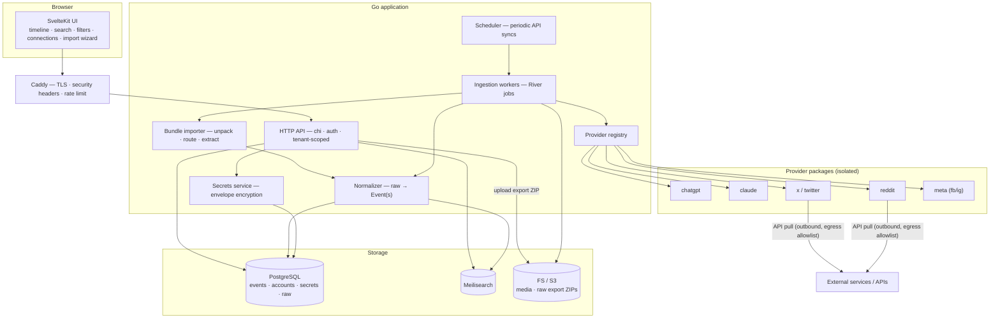
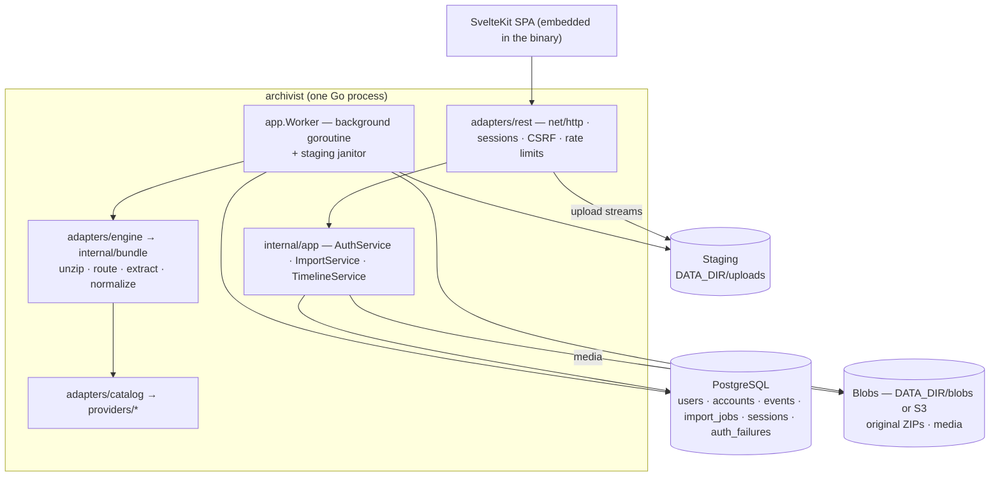
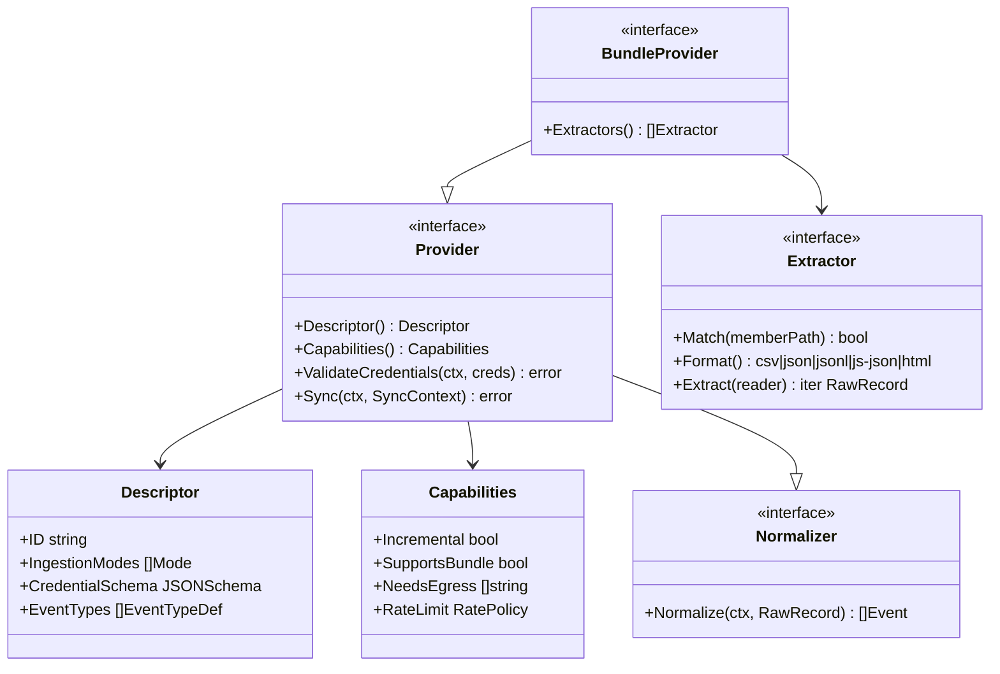
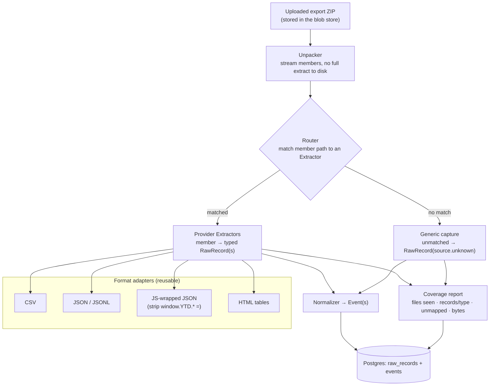
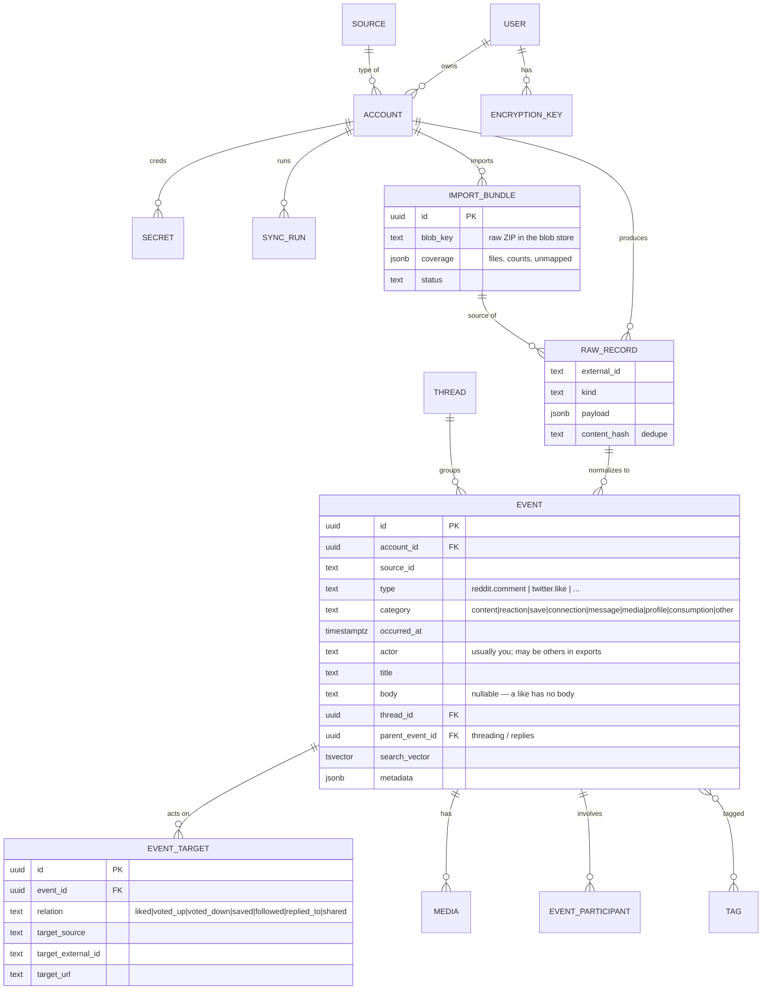
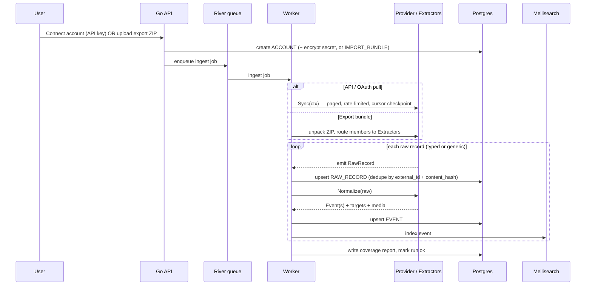
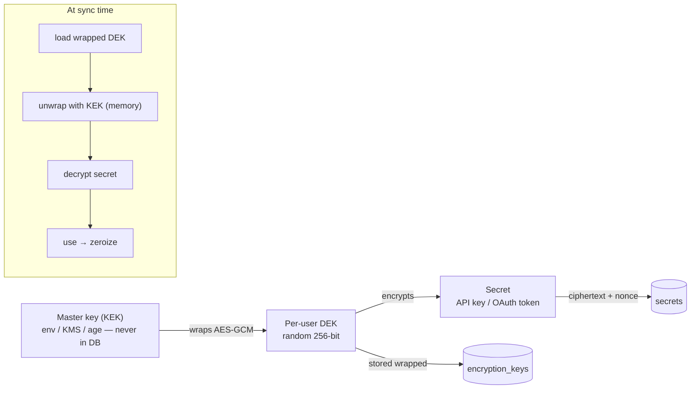

# Archivist — Architecture

A self-hosted, multi-user web application that ingests **everything** from your
external accounts — via their APIs *and* via the official data-export archives the
platforms hand you — normalizes every data type into one canonical **Event**
model, and presents it all as a single searchable, filterable timeline. Each
source is implemented as its own isolated **provider package**.

> **This is a design document (plan v2), not a description of the code.** It
> mixes what is built with what is only intended. The table below and the
> "Status" notes in every section say which is which; where they disagree with
> the prose or a diagram, the status note is right. For the code as it is, see
> [`README.md`](./README.md) and [`docs/development.md`](./docs/development.md).
> `architecture.html` renders the diagrams with the same status marked in the
> drawing: solid = built, dashed and tagged "planned" = not built.
>
> v2 of the plan added: a universal **Event** model (an event can be *anything*
> — a post, a comment, a like, a dislike, a save, a follow, a message…),
> first-class **platform export-bundle ingestion**, and a "**respect all
> data**" guarantee that nothing in an export is ever silently dropped.

---

## Implementation status

| Area | Implemented | Not implemented yet |
|---|---|---|
| Ingestion | Export-bundle import (ZIP, multi-part), async job queue + background worker with fair (round-robin per user) claiming, progress, coverage report, generic capture of unmapped members *and* of unmapped arrays inside mapped members, reprocess from the preserved archive, delete import (with the media only it stored: per-import blob ledger, 0017; media content-addressed, 0023, ADR 0017), storage quota over archives and media, uploads in flight reserved against quotas and disk, cancel a queued or running import, a per-run budget (`IMPORT_TIMEOUT`, `MAX_IMPORT_EVENTS`), janitor for orphaned uploads | Live API / OAuth pull, webhooks, scheduler, per-account sync cursors |
| Providers | Provider SPI in `internal/provider` (outside the domain); 14 in-tree bundle providers registered in `internal/adapters/catalog`, one catalog shared by application and engine (see [`docs/platforms.md`](./docs/platforms.md); only `facebook` verified against a real export) | A live-pull (API/OAuth) SPI and implementations, `init()` self-registration, out-of-process / sandboxed providers, egress allowlists, HTML export adapter |
| Data model | `users`, `accounts` (unique per user/source/label), `events`, `event_targets`, `media`, `import_jobs`, `sessions`, `auth_failures`; threading via `thread_external_id` / `parent_external_id` | `raw_records`, `import_bundles`, `sync_runs`, `threads`, `tags`, `event_tags`, `encryption_keys`, `secrets`: created by migration 0001, never used, dropped again by 0006 (wherever they were empty); `EVENT_PARTICIPANT` never existed |
| Reprocessing | Re-run providers over the write-once original ZIP | Re-normalizing from stored raw records |
| Timeline & search | Keyset pagination, source/category/type/date filters with facet counts, per-day histogram, PostgreSQL full-text search (`simple` config), media streaming | Meilisearch/Typesense, facets on connection/participants/tags/targets, thread and cross-source "activity" views |
| Storage | PostgreSQL 16 (`database/sql` + `lib/pq`), goose migrations 0001–0012, in-memory store for dev (cascades user deletion like PostgreSQL); write-once blob store: S3-compatible (minio-go; MinIO in compose, boot-time connectivity check, `/readyz` probe, CRC32C on every upload, opt-in SSE-S3, `Range` reads) or the filesystem as single-node fallback, with a migration tool between them; filesystem upload staging behind the `app.Staging` port | sqlc/pgx, River, client-side / per-user blob encryption |
| Auth | Argon2id passwords (weaker parameters upgraded on login), password policy on signup/change, opaque revocable server-side sessions stored as SHA-256 with absolute and idle timeout, atomic session replacement on login, login throttle in the shared store (`app.AttemptLimiter`), `__Host-` cookies, signup switch; OpenID Connect login through any number of configured providers (`ARCHIVIST_OIDC_*`: authorization code + PKCE, ID-token verification behind the `app.OIDCProvider` port, identities linked in `user_identities`, auto-signup and email linking per provider — only between a provider-verified email and an account whose email a provider verified (ADR 0014) — and explicit linking from the account page) | MFA/TOTP, WebAuthn, password reset by email, breached-password check |
| Secrets | Nothing to protect yet: no API keys or OAuth tokens are stored | Envelope encryption (§9) |
| Tenant isolation | `user_id` scoping in every port method, verified by shared contract tests (`internal/adapters/porttest`) | Row-Level Security (the decorative policies of 0001 were dropped in 0005), per-user DEKs |
| HTTP edge | `net/http` mux, response DTOs (golden-tested), strict query validation, per-IP token-bucket limits (IPv6 per /64), CSRF (`http.CrossOriginProtection`), CSP with hashed inline script (no `'unsafe-inline'` for scripts), HSTS/COOP headers, media allowlist + sandbox, body deadlines, `/healthz` `/readyz` `/metrics` | chi, bundled Caddy/TLS, `style-src` without `'unsafe-inline'`, rate limits shared between instances |
| Upload hardening | ZIP central-directory pre-check (entries, directory bytes, budget summed over all parts) before `archive/zip` opens a part, total (declared sizes up front)/member/record byte limits, JSON token depth ≤ 8,192 (`bundle.MaxTokenDepth`), CSV records ≤ 4 MiB and ≤ 1,024 columns, event fields capped (`domain.Event.Capped`), byte-bounded save batches, a per-run budget (`IMPORT_TIMEOUT`, `MAX_IMPORT_EVENTS`), bounded dedupe set, streaming (no extraction to disk), hashed blob keys, `os.Root` staging, provider panics contained, quotas enforced atomically, free-disk check | Resource-limited parser process, compression-ratio limit |
| Audit & supply chain | Dependencies pinned by `go.sum` (not vendored, `-mod=readonly` in the image); `make audit` (govulncheck, `npm audit`, go-licenses and license-checker allowlists, gitleaks, knip) inside `make check`, which CI runs on every push and weekly; Semgrep SAST job; actions pinned to commit SHAs and base images to digests; Renovate keeps pins current (toolchains grouped, drift checked by `scripts/check-toolchain.sh`); golangci-lint v2 and ESLint with ratchets, coverage floors, weekly mutation testing (gremlins); fleetlint tier-1 policy in the hooks and CI; non-root container | Audit log, read-only container filesystem (the image itself carries an SBOM and provenance) |

---

## 1. Goals & principles

- **Everything is an Event.** The atomic unit is an `Event`: one thing that
  happened on a source at a point in time. A Reddit comment, a Reddit post, an
  upvote, a downvote, a saved link, a subreddit subscription, a tweet, a like, a
  DM, an Instagram story, a Facebook reaction — all are Events, distinguished by a
  namespaced `type` (e.g. `reddit.comment`, `reddit.vote.down`, `twitter.like`).
- **One timeline to rule them all.** Every Event, from every source and every
  ingestion path, lands in the same model. The UI never needs to know which
  source or which import method produced an Event.
- **Respect all data.** An export archive contains dozens of data types. Every
  file and every record is accounted for: mapped to a typed Event, or captured as
  a **generic Event** (never hidden), or explicitly ignored *with a logged
  reason*. Each import emits a **coverage report**. Nothing is silently discarded.
- **Providers are isolated and pluggable.** Adding a source = adding one package
  that implements a fixed interface. Nothing else in the system changes.
- **Multiple accounts per source.** Every Event is scoped to a specific
  *connection* (`ACCOUNT` row), so two ChatGPT logins, three X accounts, etc.
  coexist cleanly.
- **Raw-first, reprocess anytime.** The original payload is stored immutably;
  normalization runs *from* it. When a mapper improves (or a new one is added for
  a previously-generic type), we re-derive Events without re-fetching or
  re-importing.
  *Status: implemented at archive granularity — the uploaded ZIP is preserved
  write-once and "reprocess" re-runs the providers over it. Per-record raw
  storage (`raw_records`) is not implemented.*
- **Secrets are the crown jewels.** API keys / OAuth tokens are encrypted at rest
  with per-user keys. *Status: not implemented; no secrets are stored today.*
- **Hardened by default.** Tenant isolation, envelope encryption, MFA,
  SSRF/egress controls, optional sandboxed providers. *Status: tenant isolation
  (application-level) is implemented; the rest is not — see §10.*

### The two ingestion realities

There is no single "download my history" REST API for most consumer accounts, so
a source is fed by one or both of:

1. **Live API / OAuth pull** — for sources with usable APIs (incremental,
   ongoing). Rate-limited and often paid (e.g. X).
2. **Platform export bundle** — the ZIP the platform delivers on request under
   GDPR/CCPA "download your data". This is how you get *comprehensive* history
   and the long tail of data types (likes, votes, saves, follows, seen-history),
   which APIs rarely expose. **ChatGPT, Claude, Twitter/X, Facebook, Instagram,
   and Reddit are all ingested primarily this way.**

The provider interface abstracts over both so the rest of the system is
identical regardless of how an Event arrived.

> **Status:** only path 2 (export bundles) is implemented. Path 1 has no code
> at all: `domain.Mode` names the modes, and `internal/provider` notes where a
> live-pull SPI would go (a sibling of `BundleProvider`), nothing more.

---

## 2. Technology stack

What the code uses today (`go.mod`, `frontend/package.json`, `Dockerfile`):

| Concern | In use | Notes |
|---|---|---|
| Backend language | **Go 1.26** | One static binary (`CGO_ENABLED=0`), UI embedded via `//go:embed`. |
| HTTP | **`net/http`** (`ServeMux` patterns, `CrossOriginProtection`, `ResponseController`) | No router dependency. |
| DB access | **`database/sql` + `lib/pq`** | Hand-written SQL in `internal/adapters/postgres`. |
| Primary store | **PostgreSQL 16** | Relational model, `jsonb` metadata, `tsvector` full-text search. An in-memory adapter serves dev and tests. |
| Migrations | **pressly/goose v3** | SQL files in `migrations/`, forward-only. A database without goose's table but with Archivist's tables (a pre-release build) is refused, not re-migrated. |
| Job queue | Own `app.Jobs` adapter on `import_jobs` | `FOR UPDATE SKIP LOCKED`, bounded crash recovery. |
| Search | PostgreSQL FTS, `simple` configuration | No stemming, not language-aware. One GIN index `(user_id, search_vector)` where `btree_gin` can be created (0024, ADR 0018), else one over all users. |
| Blob storage | Local filesystem by default; S3-compatible via **minio-go v7** (compose overlay: SILO, the maintained MinIO fork) | Original ZIPs + extracted media, write-once. `*minio.Object` gives seekable reads (ranged GETs); `TrailingHeaders` gives CRC32C checksums on single and multipart uploads; `BLOB_S3_SSE` adds SSE-S3. `cmd/archivist-blobs` migrates filesystem → S3. |
| Password hashing | **Argon2id** (`golang.org/x/crypto/argon2`) | Hashes with weaker parameters verify and are upgraded on login. |
| Rate limiting | **`golang.org/x/time/rate`** | Per client IP, in-memory, per process. The login throttle is separate and lives in the store. |
| Other | `golang.org/x/sys` (free-disk check), `google/uuid` | Pinned by `go.sum`; not vendored. |
| Frontend | **SvelteKit 3.1 / Svelte 5 / Vite 8**, JavaScript, `adapter-static` SPA (configured in `vite.config.js`; SvelteKit 3 has no `svelte.config.js`) | Node `^20.19` or `>=22.12` (image and CI: Node 26, kept in step by `scripts/check-toolchain.sh`). Built into `internal/webui/dist`; `csp` hash mode; content-hash `kit.version.name`, so the committed `dist/` is reproducible. |
| Packaging | **Docker Compose**: app + postgres, blobs on the app's volume; `deploy/compose.s3.yml` adds an S3 store (SILO, the maintained MinIO fork: pinned digest, persistent volume, `mc ready` healthcheck, console not published; the app creates the bucket at boot) | TLS is left to the operator's reverse proxy. |

Dependency policy: prefer the standard library or a well-known, maintained
library over hand-rolled protocol or crypto code; evaluate a library's health
before adding it. Dependencies are pinned by `go.sum`, not vendored (there is
no `vendor/`): `make tidy` is `go mod tidy && go mod verify`, the Dockerfile
downloads and verifies modules in a cached layer and builds with
`-mod=readonly`. `make audit` runs `govulncheck ./...`, `npm audit`, the license allowlists, gitleaks and knip, and CI runs it on every push and weekly.

Planned in v2 but **not adopted** (Status: not implemented):

| Concern | Planned choice | Notes |
|---|---|---|
| HTTP router | chi | `net/http` has been enough. |
| DB access | sqlc + pgx | |
| Job queue | River (Postgres-backed) | The `app.Jobs` port is shaped so River could replace the queue adapter. |
| Search | Meilisearch (or Typesense) | Postgres FTS was the planned zero-dependency fallback and is what exists. |
| Reverse proxy / TLS | Caddy in the compose stack | |
| Secrets/crypto | AES-256-GCM envelope encryption | See §9. |

The bias toward "Postgres-native where possible" held: the whole thing runs on
*just* Postgres plus a data directory.

---

## 3. System architecture



The only components that reach the outside world are provider packages, and only
via **outbound** calls through a per-provider egress allowlist (SSRF defense).
Export bundles need no network at all — they enter through upload.

> **Status:** the diagram above is the target design. Not implemented: Caddy,
> chi, the scheduler, River, Meilisearch, the secrets service, API pulls and
> the egress allowlist (no provider makes network calls at all). As built:



The code is hexagonal: `internal/domain` ← `internal/app` (use cases + ports)
← `internal/adapters/*`; `cmd/server/main.go` is the composition root (§11).
The use cases are three service structs (`AuthService`, `ImportService`,
`TimelineService`) plus the `Worker`, not one type per use case.

---

## 4. The provider abstraction

A provider is a self-contained Go package under `providers/<name>/`. It knows how
to authenticate to / import from **one source**, and it emits **raw records**. It
does not know about the database, the timeline, or search.

A provider declares one or more **ingestion modes**:

- `APIPull` — poll a REST/GraphQL API with a stored key.
- `OAuth` — OAuth2 auth-code flow; the system stores & refreshes tokens.
- `Bundle` — parse an official platform export archive (the focus of §5).
- `Webhook` — source pushes events (future).



Splitting `Sync`/`Extract` (fetch) from `Normalize` (map) is what makes
**reprocessing** possible: we persist every raw payload and can re-run
normalization later, including turning previously-generic records into typed
Events once a mapper exists.

> **Status:** the contracts live in `internal/provider/provider.go` — an
> adapter-level SPI (readers, member paths), so not part of the domain;
> `internal/domain/source.go` keeps only what a source *is* (`Mode`,
> `Descriptor`). They differ from the diagram: `Provider` is `Descriptor` +
> `Capabilities` + `Normalize`; `BundleProvider` adds `Extractors`; `Extractor`
> is `Match` + `Extract(memberPath, reader, emit)`. `RawRecord` carries
> `Member` and `Archive` (the uploaded ZIP's base name — WhatsApp on iOS names
> the chat only there). A provider may also implement `AttachmentMatcher`, so
> non-media files its events reference are stored as blobs. There is no
> `CredentialSchema`, `RateLimit`, `Format()`, separate `Normalizer` interface
> or `ValidateCredentials`/`Sync`. The application sees providers through two
> ports only: `ProviderCatalog{Descriptors, Known}` and
> `ArchiveEngine.Import(ctx, sourceID, in)`. Raw payloads are **not**
> persisted; reprocessing re-extracts from the preserved ZIP.

### Registration & isolation

1. **In-tree registry (start here).** Each package `init()`s into a central
   registry (`provider.Register(New())`). Providers only *emit*; they can't reach
   the DB. *Status: implemented differently — there is no `init()` registration;
   `internal/adapters/catalog/catalog.go` lists every provider explicitly,
   and `cmd/server` hands the same catalog to the application and to the
   engine (`engine.NewWith(cat.Bundler)`). Providers still only emit.*
2. **Out-of-process plugins (harden later).** Run untrusted providers as
   subprocesses over gRPC (HashiCorp **go-plugin**) inside a seccomp/landlock
   sandbox: no filesystem, network limited to declared `NeedsEgress`. The
   interface is identical, so promotion is transparent to the core.
   *Status: not implemented. Today a provider panic is recovered by the worker
   and fails only that import; that is the extent of the isolation.*

### Provider package layout

> **Status:** the layout below is the plan. In the code every provider is one
> package with a single main file (`providers/reddit/reddit.go`: descriptor,
> extractors and `Normalize` together), `testdata/` and golden tests. Shared
> code is in `providers/internal/meta` (Facebook + Instagram),
> `providers/internal/jsonwalk` (documents with dynamic or repeated keys) and
> `providers/internal/jsonpreview` (hash + preview of unmapped JSON values).

```
providers/reddit/
  provider.go       // Descriptor, Capabilities, ingestion modes
  bundle.go         // Extractors() — one per CSV in the export
  extractors/
    comments.go     // comments.csv   -> reddit.comment
    posts.go        // posts.csv      -> reddit.post
    votes.go        // *_votes.csv    -> reddit.vote.up / reddit.vote.down
    saved.go        // saved_*.csv    -> reddit.save
    subs.go         // subscribed_subreddits.csv -> reddit.subscribe
  normalize.go      // RawRecord -> Event(s)
  testdata/         // sample export fixtures + golden tests
```

---

## 5. Platform export-bundle ingestion

Export archives are structurally unlike an API: one ZIP contains **many files,
each a different data type, in different formats**. The bundle importer turns that
into a uniform stream of raw records.



**Respect-all-data guarantees** (per the chosen policy):

- Every archive member is routed. Matched members produce **typed** Events.
- Unmatched members are **captured raw** and surfaced as **generic Events**
  (`type = <source>.unknown`, category `other`) so they are visible on the
  timeline, filterable, and never invisible — not skipped.
- Every import writes a **coverage report**: which files were seen, record counts
  per Event type, which members were generic-captured, and total bytes. The
  import wizard shows it so you can confirm the whole archive was absorbed.
- Because raw is retained, adding an extractor later re-normalizes old imports
  into typed Events with no re-upload.

> **Status:** implemented, with these differences from the diagram. The upload
> is staged on disk and preserved write-once in the blob store (filesystem or
> S3), not necessarily MinIO. Nothing is written to `raw_records`; the coverage
> report is stored on the `import_jobs` row. A generic Event keeps the member
> name, size, content hash and a 240-byte preview, not the payload — the full
> bytes stay in the preserved ZIP, and "reprocess" is what re-maps them.
> Media members (images, video, audio) — and, when the provider implements
> `AttachmentMatcher`, the other files its events reference — go to the blob
> store instead of becoming generic Events. A matched member does not drop
> data silently either: arrays an extractor passes over are reported
> (`bundle.ReportSkipped`, kind `SkippedArrayKind`) and become
> `<source>.unknown` events. The engine reads parts through `io.ReaderAt`
> (`bundle.ImportParts`); there is no file-path contract with staging.
> `bundle.Limits`: 200 000 entries and a 256 MiB central directory (both
> checked by `zipcheck.go` *before* `archive/zip` opens the part; a refusal is
> a typed `*bundle.LimitError`), 20 GiB total, 4 GiB per member, 64 MiB per
> JSON record, 5 million dedupe entries (beyond that
> `Coverage.DedupeTruncated` is set and the store's upsert is the dedupe),
> JSON object nesting depth 32 (64 in `jsonwalk`). The coverage report lists
> at most 1000 generic member names; the count stays exact.

**Format adapters** are shared across providers so a new source usually only
needs mapping logic, not parsing plumbing:

- **CSV** — Reddit's export is a bundle of CSVs.
- **JSON / JSONL** — Meta (Facebook/Instagram) is folder-per-category JSON.
- **JS-wrapped JSON** — Twitter/X ships `data/*.js` files where each is a
  `window.YTD.<name>.part0 = [ … ]` assignment; the adapter strips the prefix and
  parses the array.
- **HTML tables** — Meta also offers an HTML export variant; the adapter reads its
  tables when JSON isn't chosen. *Status: not implemented; HTML exports end up
  as `<source>.unknown`.*

As built the shared adapters are `bundle.ReadCSV`, `bundle.StreamJSONArray`,
`bundle.StreamJSONArraysReport` (both report skipped arrays),
`bundle.StreamJSVarArray` (all streaming), `bundle.ReadJSON` (small members
only) and `bundle.FixMetaMojibake`; plain-text formats (WhatsApp) are parsed
in the provider.

**Encoding note (Meta):** Facebook/Instagram JSON exports mis-encode UTF-8 (bytes
escaped as if latin-1), producing mojibake. The Meta adapter repairs this
(re-encode latin-1 → UTF-8) on read, so text is stored correctly.

Concrete per-platform mapping is in the appendix; the current, per-provider
list of formats and event types is [`docs/platforms.md`](./docs/platforms.md).

---

## 6. Canonical Event model & taxonomy

Everything funnels into a small set of tables. Source-specific shape lives in
`raw_records.payload` (JSONB); the timeline reads only normalized tables.

> **Status:** the code uses `users`, `accounts`, `events` (+ `event_targets`,
> `media`), `import_jobs`, `sessions` and `auth_failures`. Source-specific
> shape lives in `events.metadata` (jsonb). `raw_records`, `import_bundles`,
> `sync_runs`, `threads`, `tags`, `event_tags`, `encryption_keys`, `secrets`
> and `users.mfa_secret` were created by migration 0001, never used, and
> dropped by 0006 (a table an operator put rows into is kept);
> `EVENT_PARTICIPANT` was never created. Events carry `user_id` directly,
> thread/reply links are the text columns `thread_external_id` /
> `parent_external_id` (the `thread_id` and `raw_record_id` FK columns went
> with their tables), and `import_job_id` records the import that last wrote
> the event. The Event, Target, Media and Category definitions are in
> `internal/domain/event.go`. `domain.Coverage` keeps JSON tags because it is
> persisted as `import_jobs.coverage` (jsonb); the API maps it to its own DTO.
>
> Migrations (goose, forward-only): 0001 initial schema · 0002 sessions + job
> attempts · 0003 multi-part imports, progress, `events.import_job_id` ·
> 0004 `import_jobs.archive_bytes` (storage quota) · 0005 drops the decorative
> RLS policies · 0006 drops the never-used tables and columns of 0001 (only
> where empty) · 0007 unique index on `accounts (user_id, source_id, label)`,
> merging existing duplicates (`Accounts.Ensure` is `INSERT … ON CONFLICT`) ·
> 0008 `import_jobs.part_names` (original upload names) · 0009
> `sessions.last_seen_at` (idle timeout) · 0010 `users.last_import_claim` +
> `import_claim_seq` (fair round-robin claims) · 0011 `auth_failures` (shared
> login throttle) · 0012 `events_timeline_order_idx` on
> `(user_id, COALESCE(occurred_at,'-infinity') DESC, id DESC)` — the keyset
> timeline page and the collapse window were a seq scan + sort without it.



### Event taxonomy

`type` is precise and namespaced (`<source>.<thing>[.<qualifier>]`); `category`
is the coarse facet the UI filters on. An event **can be anything** — content you
authored, a reaction, a save, a social connection, a message, a media upload, a
profile change, or passive consumption.

| Category | Example types | Body? | Target? |
|---|---|---|---|
| `content` | `reddit.post`, `reddit.comment`, `twitter.tweet`, `instagram.post`, `facebook.post` | yes | reply → parent |
| `message` | `twitter.dm`, `reddit.message`, `instagram.dm`, `facebook.message`, `chatgpt.message` | yes | conversation |
| `reaction` | `twitter.like`, `reddit.vote.up`, `reddit.vote.down`, `facebook.reaction`, `instagram.like` | no | **required** |
| `save` | `reddit.save`, `instagram.save`, `spotify.save` | no | **required** |
| `connection` | `twitter.follow`, `reddit.subscribe`, `facebook.friend` | no | **required** |
| `media` | `instagram.story`, `instagram.media`, `facebook.photo` | caption | — |
| `profile` | `*.profile.update`, `*.username.change`, bio edits | maybe | — |
| `consumption` | `instagram.seen`, `reddit.view`, watch history | no | required |
| `other` | `<source>.unknown` (generic capture of unmapped data) | maybe | maybe |

Per your choices: **all types are ingested** (including high-volume ones like
votes and seen-history), and filtering is a **view concern** — timeline facets
show/hide categories, so a firehose of upvotes never buries your posts. Unmapped
data is **captured raw and shown as generic Events**, never hidden or skipped.

> **Status:** the taxonomy is implemented as described (categories in
> `internal/domain/event.go`, type lists per provider in its `Descriptor`). The
> example types are illustrative — e.g. `twitter.bookmark` cannot exist because
> the X archive contains no bookmarks; [`docs/platforms.md`](./docs/platforms.md)
> has the real list.

`EVENT_TARGET` is what lets you ask cross-source questions like "everything I ever
**saved**", "every **reaction** I made in 2024", or "everyone I **followed**",
regardless of platform. *Status: targets are stored and returned with each
event; no query or view is built on them yet.*

---

## 7. Ingestion pipeline



Behaviors baked in: incremental API sync via opaque provider cursors; idempotent
upserts (unchanged `content_hash` skipped, so re-importing an overlapping export
never duplicates); durable retries with backoff honoring `Retry-After`; full
backfill vs incremental; a **re-normalize** job that rebuilds Events from stored
raw with no network/re-upload; and streaming of media/attachments to the blob store. File
imports and API pulls share this one pipeline.

> **Status:** the bundle branch is implemented; River, Meilisearch, API pulls,
> cursors, `RAW_RECORD` upserts and `Retry-After` handling are not. As built:
>
> 1. `POST /api/import` — `ImportService.Admit` checks source, quotas
>    (advisory) and free disk before the body is read; parts stream into
>    `app.Staging`; `Enqueue` creates a queued `import_jobs` row through
>    `Jobs.CreateWithin`, which enforces the quotas in the same atomic step
>    (PostgreSQL: under the user's row lock) → `202`.
> 2. `app.Worker` claims the job (`FOR UPDATE SKIP LOCKED`, round-robin across
>    users so one backlog cannot starve the rest), ensures the `accounts` row
>    (`INSERT … ON CONFLICT`), preserves each part write-once at
>    `archives/<job-id>.zip`,
>    then runs the engine: extract → in-archive dedupe by content hash →
>    `Normalize` → events buffered and upserted 500 at a time on
>    `(user_id, account_id, source_id, external_id)` (ADR 0015); media members go to the blob store;
>    progress is written at most once a second.
> 3. The outcome and coverage report are recorded on the job; staged files are
>    removed only once preserved *and* recorded. A crash leaves the job
>    `running`; `Jobs.Recover` requeues it on the next start, giving up after 3
>    attempts. A provider panic fails only that job. Shutdown lets the running
>    import finish for up to 30 s.
> 4. Reprocess requeues a finished job (parts restored from the blob store,
>    `attempts` not reset). Delete removes events → archives → job row, in that
>    order, so a partial failure can be retried.
> 5. A janitor (`ImportService.SweepStaging`, at boot and every 6 h) removes
>    staged uploads that no job references once they are older than
>    `STAGING_MAX_AGE` (default 24 h) — what a request or process that died
>    mid-upload leaves behind.

---

## 8. Timeline, search & filtering

- **Timeline query** is keyset-paginated on `(occurred_at, id)` — stable and fast
  at tens of millions of Events (an export firehose is large).
- **Facets:** source, connection, **category**, precise `type`, date range,
  participants, thread, tags, target, and free text — all composable with counts.
  Category facets are the primary lever for taming high-volume types.
- **Search:** per-user Meilisearch index over `{title, body, type, category,
  participants, occurred_at, tags}`; Postgres FTS `search_vector` is the
  no-extra-service fallback.
- **Views:** the same Event rows power a chronological timeline, a per-thread
  conversation view (chats/DMs), and cross-source activity views built on
  `EVENT_TARGET` ("everything saved", "all reactions", "all follows").
- **Days belong to the viewer.** `occurred_at` is an absolute instant stored in
  UTC, but every *day* the server draws — a histogram bucket, the collapse
  rule's "same day", the meaning of a date-only `from`/`to` — is drawn in the
  zone the request names (`?tz=Europe/Berlin`, absent ⇒ UTC). The zone travels
  inward on `app.Query.Loc` (`nil` ⇒ UTC), never as a string threaded through
  adapters; `app.LocalDay` is the single definition both stores answer to
  (memory: `t.In(loc)`; PostgreSQL: `occurred_at AT TIME ZONE $n`, the name as
  a bind parameter — which is why `Loc` must be an IANA location, not a
  `time.FixedZone`). The contract suite pins the two together on DST
  spring-forward and fall-back days, a southern-hemisphere zone and a
  half-hour-offset zone. The SPA sends the browser's zone and keeps it out of
  the URL, so a shared link renders in each reader's own days;
  `cmd/server` imports `_ "time/tzdata"` so a scratch/Alpine runtime image
  needs no zone database of its own (~410 KiB of binary).

> **Status:** implemented — keyset pagination `(occurred_at desc, id desc)`;
> server-side collapsing (`collapse=1`, `app.CollapseRule`: runs of one
> source+type ≥ 3 for consumption / ≥ 8 otherwise, same day in the viewer's
> zone, gap ≤ 30m, window of 2000 events per page) and `histogram?by=category`;
> the UI shows a symlog small-multiples chart when one source dominates and
> cluster cards;
> with undated events last (cursor encoding in `internal/app/query.go`; a
> malformed `cursor`, `from`, `to`, `tz`, `category` or `limit` is a 400, never
> silently ignored); filters and facet counts for source, category and
> type; date range; whole-word search via Postgres FTS (`simple`); a per-day
> histogram (`GET /api/events/histogram`). Not implemented: Meilisearch, the
> other facets (connection, participants, thread, tags, target), the
> thread / cross-source activity views, and any special treatment of
> high-volume consumption events (`spotify.play`, `google.youtube.watch`,
> `tiktok.watch`) — the category filter is all there is.

---

## 9. Secrets — envelope encryption

> **Status: not implemented.** There is no secrets service, KEK or DEK in the
> code. The `encryption_keys` and `secrets` tables of migration 0001 were
> never used and are dropped by 0006. This is harmless because Archivist
> stores no API keys or OAuth tokens — ingestion is by uploaded export only. The section
> stays as the design for when API pulls arrive; nothing below describes
> running code. (S3 credentials and the metrics token come from the
> environment, never the database.)

API keys and OAuth tokens never sit in the database as plaintext.



- **KEK** comes from env / secrets manager / an `age` key — never stored in the
  DB. Losing the DB alone does not expose secrets.
- **Per-user DEK** is random, stored *wrapped* by the KEK — scopes blast radius
  per user and enables rotation.
- **Secrets** are AES-256-GCM under the user's DEK; decrypted only in memory for a
  sync, then zeroized; never logged.
- **Rotation:** re-wrap DEKs to rotate the KEK; re-encrypt secrets to rotate a
  DEK. Both are online operations.

> Export bundles typically carry no long-lived credential — they're uploaded
> files — so their main protection is at-rest blob encryption (§10), not the
> secrets service. *(Status: at-rest encryption is the object store's:
> `BLOB_S3_SSE=1` requests SSE-S3 (AES256, store-managed keys) on every
> upload — AWS S3 does this by default, MinIO needs a configured KMS. There is
> no application-side or per-user encryption.)*

---

## 10. Security & multi-tenant hardening

Each paragraph states what is built first, then what remains design.

**Tenant isolation** — *Implemented:* every user-owned row carries `user_id`
(directly or through its parent), and every port method that touches user data
takes the user id and scopes by it. The shared contract suites in
`internal/adapters/porttest` exercise that on every method, against the
in-memory adapters always and PostgreSQL when `DATABASE_URL` is set. Blob and
staging namespaces are keyed by user id. *Not implemented:* Postgres
**Row-Level Security**. Migration 0001 declared policies keyed on
`app.user_id`, but the application connects as the table owner and never set
that variable, so they protected nothing; migration 0005 dropped them and
documents what a real implementation needs (non-owner role, `FORCE ROW LEVEL
SECURITY`, `SET LOCAL` per transaction, contract tests as that role). Per-user
DEKs: not implemented (§9).

**Auth & sessions** — *Implemented:* Argon2id password hashing (OWASP minimum
parameters, concurrency-bounded); hashes with weaker parameters are rehashed
on the next login; unknown emails cost a dummy hash so timing does not reveal
accounts. Sessions are opaque 256-bit random tokens, generated and
SHA-256-hashed in the application layer — stores only see the hash and an
injected clock — revocable on logout, password change and account deletion.
They end after `SESSION_TTL` (720 h) or after `SESSION_IDLE_TTL` (336 h)
without use; "last seen" is written at most once per 5 min per session. A
login creates the new session and revokes the one the browser held in one
atomic step (`Sessions.CreateReplacing`), and only if it was the same user's.
Password policy (`app.CheckPassword`): 8–1024 bytes, not the account's email,
not one repeated character — on signup and password change only, never on
login. The demo seed (`SEED_DEMO`, login `demo` / `demo`) bypasses it on
purpose, which is why `SEED_DEMO=1` is ignored against PostgreSQL unless it is
`force`. Cookies are `HttpOnly`, `SameSite=Lax`, and `Secure` + `__Host-` on
HTTPS. CSRF defence is `net/http.CrossOriginProtection` (Sec-Fetch-Site /
Origin), not tokens. Rate limits: token bucket per client IP (IPv6 per /64) on
auth and import routes, in process memory. Login throttle
(`AuthService.LogInGuarded`, the one login entry point): failures are recorded
through the `app.AttemptLimiter` port in the shared store (`auth_failures`),
so it holds across restarts and instances — 10 per (account, client) and 100
per account in 15 min, then `429` + `Retry-After` without the password being
checked. Keys are SHA-256 hashes and unknown emails are counted like known
ones, so it is no account-existence oracle; a success resets only the pair.
The client IP is the Nth-from-right `X-Forwarded-For` hop
(`TRUSTED_PROXIES=N`). Signup can be disabled. *Open:* counting and recording
a failure are two steps, so parallel attempts can overshoot a limit by their
number (bounded by the per-IP limit). *Not implemented:* **TOTP MFA**,
**WebAuthn/passkeys**, email-based password reset (OIDC login exists, see the status table), a
breached-password check (the server must work offline).

**Provider execution & egress (SSRF)** — *Implemented:* providers make no
network calls at all, and a provider panic is contained to its import. *Not
implemented:* egress allowlists, blocked private ranges, sandboxed subprocess
providers — all moot until API pulls exist.

**Untrusted upload handling** — export ZIPs are attacker-influenced input.
*Implemented:* the ZIP central directory is walked and checked against the
entry and directory-size limits *before* `archive/zip` materialises it
(`internal/bundle/zipcheck.go`, typed `*bundle.LimitError`); limits on total
and per-member uncompressed bytes, a 64 MiB cap per JSON record, bounded JSON
nesting depth, a bounded in-import dedupe set; members are streamed and never
extracted to disk, so member paths cannot traverse (blob keys are
SHA-256-hashed, staging goes through `os.Root`); upload size cap, a free-disk
check before the body is read, per-user quotas checked early and enforced
atomically with the job's creation (`Jobs.CreateWithin`); a 2 min idle timeout
on uploads; a janitor for uploads that never became an import. Stored media
is untrusted too: only a fixed allowlist of image, video and audio types is
served `inline`, everything else as `application/octet-stream` +
`Content-Disposition: attachment`, always with `nosniff`, a `sandbox` CSP and
`Cross-Origin-Resource-Policy: same-origin`. `Range` requests (206) work with
both blob stores: the S3 store's reader is a `*minio.Object`, whose Seek+Read
becomes one ranged `GET`, so `http.ServeContent` serves video from S3 the same
way as from disk *(fixed — this used to be filesystem-only)*. *Not
implemented:* a separate
resource-limited parser process, a compression-ratio limit, server-side
encryption of stored ZIPs.

**Data at rest & audit** — *Implemented:* ingested artifacts are write-once;
import and account deletion remove events, archives, staged uploads and blobs
in a retryable order (handle row last). *Not implemented:* envelope-encrypted
secrets, Postgres TDE, the append-only **audit log**, backup tooling.

**HTTP responses** — *Implemented:* responses are DTOs
(`internal/adapters/rest/dto.go`, pinned by golden JSON in `testdata/dto`),
not serialised domain structs; `user_id` and `account_id` never reach the
wire. Malformed query parameters are a 400. CSP: same-origin, and inline
scripts by hash only — SvelteKit (`csp`, mode `hash`) writes the hash of
its one bootstrap script into `index.html`, and the server builds its header
from the embedded file (`rest/csp.go`), so the two cannot drift; if the shell
carries no hash (frontend not built) it falls back to `'unsafe-inline'` and
logs a warning. HSTS (when cookies are Secure), COOP, `X-Frame-Options`,
`Permissions-Policy`, `nosniff`; 500s and `/readyz` never echo internal
errors; `/metrics` can require a bearer token. *Open:* `style-src` still
allows `'unsafe-inline'` (Svelte sets style attributes).

**Supply chain** — *Implemented:* deps pinned by `go.sum` (not vendored;
`go mod verify` in `make tidy` and in the image build, `-mod=readonly`);
`make audit` (govulncheck, `npm audit`, license allowlists, gitleaks, knip) runs in CI on every push and weekly; non-root
container. *Not implemented:* running that scan in CI, Dependabot, SBOM,
read-only container filesystem.

---

## 11. Repository layout

As built (hexagonal: **domain ← application ← adapters**):

```
archivist/
  cmd/
    server/            # composition root: main.go (wiring, worker, shutdown),
                       #   config.go (all environment parsing)
    archivist-demo/    # CLI: import a ZIP, print the coverage report
  internal/
    domain/            # Event, User, ImportJob, Coverage; source.go: Mode,
                       #   Descriptor
    provider/          # provider SPI: Provider, BundleProvider, Extractor,
                       #   RawRecord, AttachmentMatcher, Lookup
    app/               # use cases + driven ports (ports.go, auth.go, import.go,
                       #   timeline.go, query.go, app.go)
    adapters/
      memory/          # in-memory repositories, jobs, sessions, attempts;
                       #   store.go wires them with cascading user deletion
      postgres/        # PostgreSQL repositories, jobs, sessions, attempts,
                       #   goose runner
      crypto/          # Argon2id password hasher
      blob/            # write-once blob store: S3 (minio-go, seekable reads,
                       #   checksums, SSE), filesystem; MigrateFS between them
      staging/         # staged uploads on disk (os.Root), free-disk check
      catalog/         # provider registry
      engine/          # app.ArchiveEngine over internal/bundle
      rest/            # net/http API: server.go, dto.go (+ testdata/dto),
                       #   csp.go, media.go, middleware.go, ratelimit.go; SPA
      porttest/        # shared port contract test suites
    bundle/            # zipcheck, unzip, route, format adapters, dedupe,
                       #   limits, skipped-array reporting
    webui/             # //go:embed of the built frontend (dist/)
    seed/              # demo data
    archivetest/       # test helper: build ZIPs from fixtures
  providers/
    chatgpt/ claude/ discord/ facebook/ google/ instagram/ linkedin/ reddit/
    snapchat/ spotify/ telegram/ tiktok/ twitter/ whatsapp/
    internal/meta/ internal/jsonwalk/ internal/jsonpreview/
  frontend/            # SvelteKit app (adapter-static → internal/webui/dist);
                       #   src/lib/exportGuides.js drives /help/exports, the
                       #   footer, the import-form hints and docs/exports.md
                       #   (scripts/gen-export-docs.mjs, `make export-docs`)
  migrations/          # goose SQL, 0001–0012 (§6)
  docs/                # platforms.md, exports.md (generated), reddit.md
  Dockerfile  docker-compose.yml  Makefile
```

The v2 plan foresaw `cmd/worker`, `internal/{provider,ingest,event,timeline,
search,secrets,auth,store,httpapi}`, `web/` and `deploy/`. Of these only
`internal/provider` exists (as the SPI alone, not a registry): the worker runs
inside the server process, and the other responsibilities landed in the
packages above (`search`, `secrets` and MFA have no counterpart at all).

---

## 12. Delivery roadmap

Status markers: **[done]**, **[partly]**, **[open]**.

**Phase 1 — Core + chats + first bundles.** Data model (Event + targets)
**[done]**, auth **[done]** (passwords, OIDC login) + MFA **[open]**, secrets service **[open]**,
provider registry **[done]**, the **bundle importer** (unpacker + router +
CSV/JSON/JS-JSON adapters + coverage report) **[done]**, pipeline **[done]**,
timeline + filters + search **[done]** (Postgres FTS). `chatgpt` + `claude`
(chat export) and `reddit` (full CSV export) **[done]**, against synthetic
fixtures.

**Phase 2 — The big social exports.** `twitter/x` archive `data/*.js`
**[done]**: tweets (incl. replies, retweets, media), DMs and group DMs, likes,
follows, followers, blocks, mutes, lists, saved searches, Moments, note-tweets,
account/profile. Bookmarks are not part of the X archive.
`meta` (Facebook + Instagram JSON, with the encoding repair) **[done]** —
Facebook against a real export, Instagram against fixtures. The X **OAuth API
pull** **[open]**. Beyond the plan, eight more bundle providers were added:
`google` (YouTube), `whatsapp`, `tiktok`, `telegram`, `snapchat`, `spotify`,
`linkedin`, `discord` **[done]**, fixtures only.

**Phase 3 — Hardening & scale.** Zip-bomb/upload hardening review **[done]**
(limits, central-directory pre-check, atomic quotas, record cap, streaming,
staging janitor). Also done here, though not in the original plan: revocable
hashed sessions with idle timeout, Argon2id, password policy, rate limiting,
a login throttle in the shared store, CSRF, security headers with a hash-based
script CSP, response DTOs, media allowlist, fair import scheduling, contract
tests for tenant scoping, S3 blob store (with `Range`, boot check, readiness
probe, checksums, migration tool), goose
migrations. Vulnerability scanning **[done]** (`make audit` in `make check`, run by CI on every push and weekly).
Sandboxed subprocess providers **[open]**. RLS on by default
**[open]** — the first attempt was decorative and was removed (0005). Audit-log
UI, WebAuthn, Meilisearch tuning, per-account scheduling **[open]**.

**Later.** Assisted/automated export capture, webhook ingestion, unified-archive
export of *your* data, and cross-source dedupe/merge (e.g. the same link you
saved on two platforms) — all **[open]**. Nearer-term provider work is ranked
in [`docs/platforms.md`](./docs/platforms.md): verifying the fixture-only
providers against real exports (they are reconciled against public parsers and
docs, fuzz-tested, but still fixture-only), and the remaining Google Takeout
products (Gmail, Calendar, Play Store purchases, Access Log).

---

## Appendix — where the data comes from, concretely

> **Status:** written for the original six sources and partly aspirational
> (`twitter.bookmark` cannot exist — the X archive has no bookmarks; conversation
> `THREAD` rows and the live X sync do not exist). The maintained list of providers, formats and event
> types is [`docs/platforms.md`](./docs/platforms.md).

- **ChatGPT / Claude:** chat history via the platform **data export** (ZIP with
  `conversations.json`); the developer API key is for inference, not history.
  → `chatgpt.message`, `claude.message`, grouped into conversation `THREAD`s.
- **Reddit:** the GDPR export is a ZIP of **CSV** files — `comments.csv`,
  `posts.csv`, `post_votes.csv`, `comment_votes.csv`, `saved_posts.csv`,
  `saved_comments.csv`, `subscribed_subreddits.csv`, messages/chat, and more.
  → `reddit.comment`, `reddit.post`, `reddit.vote.{up,down}`, `reddit.save`,
  `reddit.subscribe`, `reddit.message`.
- **Twitter / X:** the account archive is an HTML viewer plus `data/*.js` files,
  each a `window.YTD.<name>.part0 = [ … ]` assignment wrapping JSON — `tweets.js`,
  `like.js`, `follower.js`, `following.js`, `direct-messages.js`, `account.js`,
  etc. Live incremental sync additionally via OAuth2 + REST (rate-limited/tiered).
  → `twitter.tweet`, `twitter.like`, `twitter.follow`, `twitter.follower`,
  `twitter.dm`, `twitter.dm_event`, `twitter.block`, `twitter.mute`,
  `twitter.list`, `twitter.saved_search`, `twitter.moment`,
  `twitter.note_tweet`, `twitter.account` (no bookmarks — not in the archive).
- **Meta (Facebook / Instagram):** folder-per-category **JSON** (or an HTML
  variant), covering posts, comments, reactions, saved items, messages, stories,
  media, and profile info. Text needs a **UTF-8/latin-1 mojibake repair** on read.
  → `facebook.*` and `instagram.*` types across all categories.
- **General rule:** treat "API key" as one credential type among several. The
  provider interface abstracts over API pulls, OAuth, and export bundles, and the
  Event model absorbs *every* data type each source contains.
