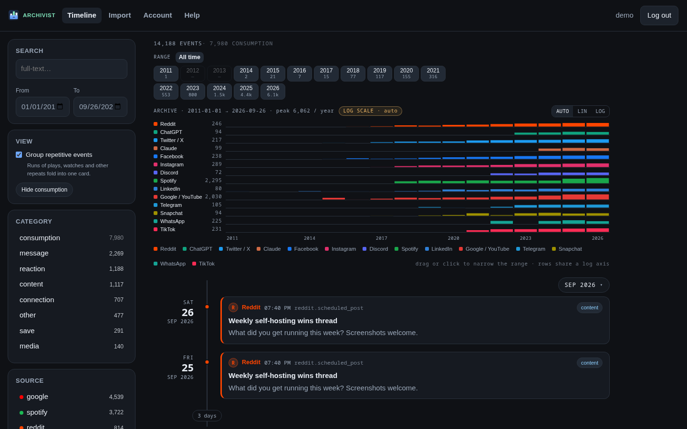
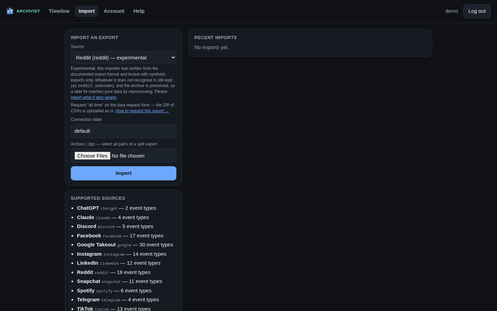

<p align="center">
  
</p>

# Archivist

Self-hosted, multi-user archive of your external accounts. Archivist ingests the
official **data-export ZIPs** the platforms hand you, normalizes every data type
into one canonical `Event`, and shows it all on a searchable, filterable
timeline. Go backend, SvelteKit frontend (embedded in the Go binary),
PostgreSQL.



- Design and implementation status: [`ARCHITECTURE.md`](./ARCHITECTURE.md). It
  is a design document; its status table says which parts exist.
- Supported platforms, export formats and verification status:
  [`docs/platforms.md`](./docs/platforms.md).
- Contributor guide (layout, conventions, testing): [`docs/development.md`](./docs/development.md).

## Run it

With Docker (or podman) and the published image — `linux/amd64` and
`linux/arm64`:

```bash
git clone --branch v0.1.0 https://github.com/johnnycube/archivist && cd archivist
cp .env.example .env
docker compose -f docker-compose.yml -f deploy/compose.registry.yml up -d
docker compose exec app /app/archivist admin create-user -email you@example.com   # prints a password
```

Open <http://localhost:8080>, log in, pick a source on the import page and
drop in its export ZIP. [`docs/exports.md`](./docs/exports.md) (in the app:
*How to get your exports*) says how to request each one. Platforms that split
large exports into several ZIPs: upload all parts in one import.



That stack is PostgreSQL and the app, with the uploaded archives and extracted
media on the app's volume, listening on `127.0.0.1` only. Before anyone else
uses it, read the next section.

## Running it for real

Archivist is meant for a single node behind an HTTPS reverse proxy.

1. **A reverse proxy with TLS** in front of `127.0.0.1:8080`.
   [`deploy/Caddyfile.example`](./deploy/Caddyfile.example) is a complete
   Caddy configuration (certificates included); with nginx or Traefik, forward
   `X-Forwarded-For` and `X-Forwarded-Proto` and allow request bodies up to
   `MAX_UPLOAD_MB` (8 GiB by default).
2. **`.env`**, next to `docker-compose.yml`:
   ```bash
   COOKIE_SECURE=1                          # cookies over HTTPS only (__Host- prefix)
   TRUSTED_PROXIES=1                        # one proxy in front
   PUBLIC_URL=https://archive.example.com   # also the base of OIDC callbacks
   METRICS_TOKEN=<random, 16+ characters>   # or block /metrics at the proxy
   ```
   Signup stays closed (`ALLOW_SIGNUP=0`): create accounts with
   `archivist admin create-user` ([Administration](#administration)), or add
   an identity provider ([OIDC login](#oidc-login)). The full list of settings
   is under [Configuration](#configuration).
3. **Storage**: the uploaded archives are kept (they are what *Reprocess*
   works from), so plan for roughly the size of the exports plus the media in
   them. The default quota is 50 GiB per user (`MAX_USER_ARCHIVE_GB`). For an
   S3 object store instead of the volume, see [Blob storage](#blob-storage).
4. **Backups** (below) and **upgrades**: `deploy/deploy.sh <version>` pulls a
   release, restarts and waits until it is ready
   ([Deploying](#deploying-from-the-container-registry)); read the release
   notes and [`docs/upgrading.md`](./docs/upgrading.md) first.

### Backups

The database and the stored archives refer to each other: back them up
together, while no import runs (stopping the app is simplest).

```bash
docker compose stop app
docker compose exec -T db pg_dump -U archivist -Fc archivist > archivist-db-$(date +%F).dump
docker compose run --rm -T --no-deps --entrypoint tar app czf - -C /data . > archivist-data-$(date +%F).tgz
docker compose start app
```

To restore, on a fresh stack: `docker compose up -d db`, then
`docker compose exec -T db pg_restore -U archivist -d archivist --clean --if-exists < archivist-db-….dump`,
`docker compose run --rm -T --no-deps --entrypoint tar app xzf - -C /data < archivist-data-….tgz`,
and `docker compose up -d`. With the S3 overlay the blobs live in the bucket
instead: copy it alongside the dump (for example `mc mirror`).

## Deploying from the container registry

Every release is published as a multi-platform image (linux/amd64 and
linux/arm64) at **`ghcr.io/johnnycube/archivist`**, with an SBOM and build
provenance attached, signed keyless with cosign. Verify one before running it:

```bash
cosign verify ghcr.io/johnnycube/archivist:0.1.0 \
  --certificate-identity-regexp '^https://github.com/johnnycube/archivist/\.github/workflows/release\.yml@' \
  --certificate-oidc-issuer https://token.actions.githubusercontent.com
```

The release workflow ([`.github/workflows/release.yml`](./.github/workflows/release.yml))
runs on a version tag (`git tag -s v1.2.3 && git push origin v1.2.3` →
`:1.2.3`, `:latest`, `:sha-<12 hex>`, and a release with notes). On GitHub it
needs no setup; it also runs on Gitea Actions, against Gitea's registry — its
header lists the variable and secrets that needs. A manual run publishes the
current branch as `:<branch>` and `:sha-<12 hex>`.

On the host, in a checkout (or a directory holding `docker-compose.yml`,
`deploy/` and your `.env`):

```bash
deploy/deploy.sh                 # pull :latest, docker compose up -d, wait for /readyz
deploy/deploy.sh 1.2.3           # a specific version; roll back the same way
REGISTRY=git.example.com IMAGE_NAME=me/archivist REGISTRY_USER=me REGISTRY_TOKEN=... deploy/deploy.sh   # another, private registry: logs in first
```

[`deploy/compose.registry.yml`](./deploy/compose.registry.yml) layers
`image: ${ARCHIVIST_IMAGE}` over the `app` service of `docker-compose.yml`, so
the database and blob-store settings stay in one place; `ARCHIVIST_IMAGE`,
`REGISTRY`, `IMAGE_NAME`, `ARCHIVIST_COMPOSE_OVERLAYS` (e.g.
`deploy/compose.s3.yml`), `APP_URL` and `COMPOSE` (`podman compose`,
`docker-compose`) can also live in `.env`. The script prints the previous image
before switching and the `/healthz` version after.

## What works

- **Accounts**: signup, login, logout, password change, account deletion.
  Signup is closed unless the operator opens it with `ALLOW_SIGNUP=1`;
  accounts are created with `archivist admin create-user` (see
  [Administration](#administration)). Logins through OpenID Connect
  providers are configured with `ARCHIVIST_OIDC_*` (see [OIDC login](#oidc-login)).
  New passwords must be 8–1024
  bytes, not the account's email and not one repeated character.
- **Imports**: asynchronous. The upload streams to disk, a queued
  `import_jobs` row is returned with `202`, a background worker processes it
  (one at a time, round-robin across users, so one user's backlog does not
  starve the others), and the UI polls for progress. Every import ends with a
  **coverage report** (members seen, mapped and captured generically, events
  per type, duplicates, new vs. re-imported events, media stored).
- **14 providers** under `providers/`: `reddit`, `chatgpt`, `claude`,
  `twitter`, `instagram`, `facebook`, `google` (Takeout: YouTube), `whatsapp`,
  `tiktok`, `telegram`, `snapchat`, `spotify`, `linkedin`, `discord`. Only
  `facebook` was developed against a real export; the others are tested against
  synthetic fixtures only — see [`docs/platforms.md`](./docs/platforms.md).
  Anything a provider does not recognise — an unmatched file, or an array
  inside a matched JSON file that the provider has no mapping for — becomes a
  `<source>.unknown` event, so nothing in an archive is silently dropped.
  How to request each service's export, and which options to choose:
  [`docs/exports.md`](./docs/exports.md) (in the app: `/help/exports`).
- **Timeline**: newest first, keyset-paginated, filterable by source, category,
  type, date range and full-text search (PostgreSQL `tsvector`, `simple`
  configuration — no stemming), with facet counts, a per-day histogram and
  attachments served from the blob store: images, video and audio inline,
  anything else (a chat's PDFs, vCards, …) as a download. Days are the
  **viewer's** days: the browser sends its IANA zone as `tz=` and the server
  filters, buckets and groups on that zone's midnights, so a card never appears
  under a heading outside the range you pinned.
- **Reprocess and delete**: every import's original ZIP is preserved
  write-once. *Reprocess* re-runs the current providers over it — this is how a
  provider improvement reaches data imported earlier — and, once the run has
  completed, removes the import's events it no longer derives (counted as
  `superseded` in the coverage report). Each import names its
  account (`?account=<label>`, default `default`); events are unique per
  account, so two accounts of one source never share or overwrite an event.
  *Delete* removes the
  import's events (those no later import has refreshed), the media it stored
  that no other import of yours stored too, its archive and the job.
- **Abuse limits**: upload size cap, per-user active-import and
  storage quotas (archives and extracted media; enforced atomically with the
  job's creation), uploads in flight reserved against the user's quotas and
  the free staging disk until they become an import (one without a declared
  length reserves `MAX_UPLOAD_MB`), a budget per import (run time
  `IMPORT_TIMEOUT`, `MAX_IMPORT_EVENTS`; its owner can also cancel it, and it
  stops within seconds — the queue is shared, so no archive may hold it
  indefinitely), and parser limits for hostile
  archives: entry count and central-directory size checked before the ZIP is
  opened and summed over all parts of an import; total (declared sizes checked
  up front) and per-member bytes; 64 MiB per JSON record and at most 8,192
  levels of JSON nesting; 4 MiB per CSV record and 1,024 CSV columns; a
  bounded dedupe set. An event's text is capped (title 4 KiB, body 1 MiB,
  metadata 256 KiB) and the cut is recorded on the event and counted in the
  coverage report; the original stays in the preserved archive.
- **Housekeeping**: a janitor removes staged uploads that never became an
  import once they are `STAGING_MAX_AGE` old (at boot, then every 6 h).
- **Operations**: `/healthz`, `/readyz`, structured logs, graceful shutdown,
  crash recovery of interrupted imports, and Prometheus `/metrics` (behind
  `METRICS_TOKEN`): requests per route and status class with latency
  histograms (`archivist_http_*`), import runs per source and outcome
  (`archivist_imports_total{outcome="done|cancelled|timeout|too_many_events|archive_error|server_fault"}`),
  their duration and events written, the queue (`archivist_imports_queued`,
  `archivist_imports_running`), and the Go runtime and process.

Not implemented: live API/OAuth pulls (export ZIPs are the only ingestion
path), MFA, password reset by email, encryption of stored secrets (there are
none), an external search engine, an audit log. `ARCHITECTURE.md` describes
these as design only.

## HTTP API

JSON over cookies. `(auth)` routes need a session; errors are
`{"error": "..."}`. Responses are explicit DTOs
(`internal/adapters/rest/dto.go`, pinned by golden files), not the domain
structs; internal ids (`user_id`, `account_id`) are not on the wire.

```
POST   /api/auth/signup     {email,password}   create account, set session cookie
POST   /api/auth/login      {email,password}   set session cookie
POST   /api/auth/logout                        revoke the session
GET    /api/auth/me                            current user
POST   /api/auth/password   {current,new}      change password, revoke other sessions (auth)
POST   /api/auth/delete     {password}         delete the account and all its data   (auth)
GET    /api/auth/oidc                          configured identity providers
GET    /api/auth/oidc/{id}/start               log in through a provider (browser navigation)
POST   /api/auth/oidc/{id}/link                link a provider to this account → {url}  (auth)

GET    /api/sources                            sources + their event types
POST   /api/import?source=<id>&account=<label> multipart; one 'archive' file field
                                               per ZIP part → 202 + queued job       (auth)
GET    /api/imports                            20 most recent import jobs            (auth)
GET    /api/imports/{id}                       status, progress, coverage            (auth)
POST   /api/imports/{id}/reprocess             requeue a finished import → 202       (auth)
POST   /api/imports/{id}/cancel                cancel a queued or running import     (auth)
DELETE /api/imports/{id}                       delete import, events, archive        (auth)

GET    /api/events?source=&category=&type=&q=&from=&to=&tz=&limit=&cursor=           (auth)
       &collapse=1[&collapse_gap=30m]         items: events + cluster summaries      (auth)
GET    /api/events/histogram?<same filters>[&by=source|category]                     (auth)
GET    /api/events/{id}                                                              (auth)
GET    /api/events/{id}/media/{idx}            stream an attachment                  (auth)

GET    /healthz   /readyz   /metrics           liveness, readiness, Prometheus
GET    /                                       web UI (embedded SPA)
```

`collapse=1` folds runs of consecutive events of one source and type (≥ 3 for
`consumption`, ≥ 8 otherwise, same day in `tz`, gaps ≤ `collapse_gap`, default
30m) into
`{"kind":"cluster",count,first_at,last_at,sample_titles,first_id,last_id}`
items; `limit` counts items and a run cut by a page boundary continues as a new
cluster on the next page (the UI merges them). Members of a cluster are fetched
with the plain endpoint and `from=last_at&to=first_at`.

**Days are the viewer's.** Timestamps are stored and returned in UTC, but every
day boundary the server draws is drawn in `tz`, an optional IANA zone name
(`tz=Europe/Berlin`). Absent or empty it is **UTC**, so a request that names no
zone behaves exactly as it always did. `tz` decides three things:

- a **date-only** `from`/`to` is that calendar day *there* — `from=2024-03-01`
  starts at `2024-03-01T00:00+01:00` and `to=2024-03-31` ends at the last
  instant of 31 March local (a spring-forward day is 23 h long, a fall-back day
  25 h; a full RFC 3339 bound keeps its own offset and is unaffected);
- the histogram's `day` keys are calendar days there;
- `collapse=1` cuts a run at local midnight.

An unknown or malformed zone is a `400`. The SPA sends the browser's own zone
(`Intl.DateTimeFormat().resolvedOptions().timeZone`) and deliberately keeps it
out of the address bar: a shared link shows each reader their own days.

`source`, `category` and `type` take comma-separated lists; `from`/`to` are
RFC 3339 or `YYYY-MM-DD`; `limit` defaults to 50 (max 500). A page carries
`events`, `next_cursor`, `facets` and `total`; `facets` and `total` describe the
whole filtered set and come with the first page only (no `cursor`) — later
pages of the same query carry `total: 0` and empty facets. A read that runs
longer than 30 s is cut off with `503`. Status codes worth knowing: a
malformed `from`, `to`, `tz`, `category`, `limit` or `cursor` is `400` (nothing is
silently ignored); reprocessing a queued or running import, deleting a running
one, and deleting an account while an import is active, are `409`; too many
active imports is `429`; too many failed logins is `429` with `Retry-After`
(the same answer whether or not the account exists); a password the policy
refuses is `400` with the reason; an upload over `MAX_UPLOAD_MB` or over the
storage quota is `413`; a full disk is `507`; closed signup is `403`. A `500`
never carries the internal error text — it is logged instead; the same holds
for an import that fails on the server's side (database, blob store), whose
job says so in general terms, while a problem with the archive itself is
reported as such. Free-text parameters (`q`, `source`, `type`, `account`, …)
must be valid UTF-8 without NUL bytes; `q` is at most 512 bytes.

Media: a fixed allowlist of image, video and audio types is served `inline`;
everything else is `application/octet-stream` with
`Content-Disposition: attachment`. Every media response carries `nosniff`, a
`sandbox` CSP and `Cross-Origin-Resource-Policy: same-origin`. `Range` requests
(`206`, `Accept-Ranges`, `If-Range` — what makes video and audio seek, and what
Safari needs to play video at all) work with both blob stores; from S3 a range
costs one ranged `GET`, nothing is fetched ahead of the client.

```bash
curl -c jar -X POST -H 'Content-Type: application/json' \
  -d '{"email":"me@example.com","password":"password123"}' localhost:8080/api/auth/signup
curl -b jar -F "archive=@reddit_export.zip" "localhost:8080/api/import?source=reddit"
curl -b jar "localhost:8080/api/events?category=reaction&limit=20"
```

(The example assumes `COOKIE_SECURE=0`, as `make run` and the compose file set
it. With secure cookies — the default — talk to the server over `https://`.)

## Configuration

Environment variables, parsed and validated at startup
(`cmd/server/config.go`); an invalid value stops the server with every problem
listed. [`.env.example`](./.env.example) has the long form.

| Variable | Default | Meaning |
|---|---|---|
| `ADDR` | `:8080` | Listen address |
| `DATABASE_URL` | — | Required: a PostgreSQL DSN, or `memory` for the in-memory development store (nothing persists) |
| `MIGRATE` | `0` | `1` applies pending `migrations/` on boot |
| `MIGRATIONS_DIR` | `migrations` | Where the migration files are |
| `DATA_DIR` | `./data` | Staged uploads (`uploads/`) and filesystem blobs (`blobs/`); must persist |
| `MAX_UPLOAD_MB` | `8192` | Cap on one import upload, all parts together |
| `MAX_ACTIVE_IMPORTS` | `3` | Queued, running and still-uploading imports per user |
| `MAX_USER_ARCHIVE_GB` | `50` | Storage a user's imports may occupy (GiB): uploaded archives plus extracted media, and uploads in flight |
| `IMPORT_TIMEOUT` | `12h` | An import running longer is stopped (at least `1m`; `0` = no limit) |
| `MAX_IMPORT_EVENTS` | `25000000` | An import whose archive yields more events is stopped there |
| `ALLOW_SIGNUP` | `0` | `1` opens password registration to anyone who reaches the server; closed, signup answers 403 and accounts come from `archivist admin create-user` |
| `ARCHIVIST_OIDC_PROVIDERS` | unset | Comma-separated ids of OpenID Connect providers to log in through (see [OIDC login](#oidc-login)) |
| `ARCHIVIST_OIDC_<ID>_ISSUER` | — | The provider's issuer URL (discovery runs at boot); required per provider |
| `ARCHIVIST_OIDC_<ID>_CLIENT_ID` | — | OAuth client id; required per provider |
| `ARCHIVIST_OIDC_<ID>_CLIENT_SECRET` | unset | OAuth client secret; unset = public client (PKCE only) |
| `ARCHIVIST_OIDC_<ID>_NAME` | the id, capitalised | Label of the login button ("Continue with …") |
| `ARCHIVIST_OIDC_<ID>_SCOPES` | `openid email profile` | Scopes to request (`openid` is always included) |
| `ARCHIVIST_OIDC_<ID>_REDIRECT_URL` | from `PUBLIC_URL` | The callback URL registered with the provider: `https://<host>/api/auth/oidc/<id>/callback` |
| `ARCHIVIST_OIDC_<ID>_AUTO_SIGNUP` | `1` | `0`: only existing (linked or email-matched) accounts may log in |
| `ARCHIVIST_OIDC_<ID>_LINK_BY_EMAIL` | `1` | `0`: never attach a first login to an existing account by email (it happens only when the provider and the account both verified the address) |
| `PUBLIC_URL` | unset | Where users reach the server (`https://archive.example.com`); the base of the OIDC callback URLs, and required with OIDC unless every provider has its own `REDIRECT_URL` |
| `STAGING_MAX_AGE` | `24h` | Age at which the janitor removes uploads that never became an import (at least `1h`) |
| `SESSION_TTL` | `720h` | Login lifetime (Go duration, at least `1m`) |
| `SESSION_IDLE_TTL` | `336h` | A session unused this long ends (at least `15m`; `0` disables; no effect if >= `SESSION_TTL`) |
| `COOKIE_SECURE` | `1` | `0` only for plain-HTTP local development |
| `TRUSTED_PROXIES` | `0` | Number of reverse proxies appending to `X-Forwarded-For` |
| `TRUSTED_ORIGINS` | unset | Extra origins the CSRF check accepts (comma-separated) |
| `METRICS_TOKEN` | unset | Bearer token for `/metrics` (at least 16 chars); unset = open |
| `LOG_FORMAT` | `json` | `json` or `text` |
| `SEED_DEMO` | unset | `1` seeds the demo account `demo` / `demo` (in-memory only; ignored with `DATABASE_URL`); `force` also seeds PostgreSQL |
| `BLOB_S3_ENDPOINT` | unset | Set to store blobs in an S3-compatible object store (the shipped deployment); unset = filesystem under `DATA_DIR/blobs` |
| `BLOB_S3_BUCKET` | `archivist` | Bucket (created at boot if missing) |
| `BLOB_S3_ACCESS_KEY`, `BLOB_S3_SECRET_KEY` | unset | Credentials (checked at boot; the server refuses to start if they are rejected or the endpoint is unreachable) |
| `BLOB_S3_REGION` | `us-east-1` | Region |
| `BLOB_S3_SSE` | `0` | `1` requests SSE-S3 (AES256) on every upload — needs a KMS on MinIO/SILO; AWS S3 encrypts by default |

`docker-compose.yml` additionally sets `GOMEMLIMIT` (Go runtime soft heap
limit; keep it at 80–90 % of a container memory limit). The optional S3
overlay `deploy/compose.s3.yml` reads `MINIO_ROOT_USER` / `MINIO_ROOT_PASSWORD`
from `.env` for the object store and the app alike, and will not start without
them.

### Administration

The server binary carries the operator's commands. They use the same
configuration as the server (`DATABASE_URL`, `DATA_DIR`, `BLOB_S3_*`) and work
on its database, so in Docker run them inside the app container:

```bash
docker compose exec app /app/archivist admin create-user -email you@example.com
docker compose exec app /app/archivist admin list-users
docker compose exec app /app/archivist admin reset-password -email you@example.com
docker compose exec app /app/archivist admin list-imports -email you@example.com
docker compose exec app /app/archivist admin cancel-import -email you@example.com -id <job id>
docker compose exec app /app/archivist admin delete-user -email you@example.com -yes
```

`create-user` and `reset-password` print a generated password once, or read
one from standard input with `-password-stdin`; the password policy applies.
`create-user` works while signup is closed — it is how the first account of a
new instance is made. A password reset ends the account's sessions.
`delete-user` removes the account and all its data, as the account page does;
it refuses while one of its imports is queued or running.

### OIDC login

Any number of OpenID Connect providers (Gitea, Keycloak, Authentik, Google,
…) can sit next to the password login. List their ids and configure each one
by id, upper-cased with `-` as `_`:

```bash
ARCHIVIST_OIDC_PROVIDERS=gitea,google
ARCHIVIST_OIDC_GITEA_ISSUER=https://gitea.example.com
ARCHIVIST_OIDC_GITEA_CLIENT_ID=...
ARCHIVIST_OIDC_GITEA_CLIENT_SECRET=...
ARCHIVIST_OIDC_GITEA_NAME="Company Gitea"
ARCHIVIST_OIDC_GOOGLE_ISSUER=https://accounts.google.com
ARCHIVIST_OIDC_GOOGLE_CLIENT_ID=...
ARCHIVIST_OIDC_GOOGLE_CLIENT_SECRET=...
ARCHIVIST_OIDC_GOOGLE_AUTO_SIGNUP=0        # Google accounts may only log in to existing users
```

Register `https://<your host>/api/auth/oidc/<id>/callback` as the redirect
URL at the provider. The server builds it from `PUBLIC_URL`
(`PUBLIC_URL=https://archive.example.com`), or takes
`ARCHIVIST_OIDC_<ID>_REDIRECT_URL` as is; it refuses to start with a provider
that has neither, rather than take the URL from a request's `Host` header,
which a client chooses. Discovery runs at boot: a provider that cannot be
reached, or an invalid issuer, stops the server with a clear error.

The login page shows one "Continue with …" button per provider. A login is
the authorization-code flow with PKCE; the ID token's signature, issuer,
audience, expiry and nonce are verified. The asserted identity (provider,
subject) is matched in this order: an account it is already linked to; the
account with the same email, if `LINK_BY_EMAIL` is on and **both** the
provider and the account have verified that address; otherwise a new account
is created when `AUTO_SIGNUP` is on (the provider must supply a verified
email). A password signup never verifies its address, so a provider login is
never attached to a password account automatically — that would let anyone
who registered your address first receive your provider login. Instead, the
owner links the provider once from the **account page** ("Linked logins"),
while signed in. An account created by a provider login has no password until
its owner sets one on the account page; it can log in through the provider
only. Closed signup (`ALLOW_SIGNUP=0`) does not affect provider logins — the provider's user
base is the allow-list; use `AUTO_SIGNUP=0` to restrict a provider to existing
accounts. See [ADR 0014](./docs/adr/0014-oidc-email-linking-needs-a-verified-account.md).

### Blob storage

Original export ZIPs and extracted media are blobs: write-once, never
rewritten. Media is stored under the SHA-256 of its content, so two exports
with a file of the same name each keep their own, and a file in several
exports is stored once
([ADR 0017](./docs/adr/0017-content-addressed-media.md)). By default they live on the **local filesystem** under
`DATA_DIR/blobs` — in `docker-compose.yml` on the app's volume. That serves a
single node and is the simplest thing to back up.

Alternatively they go to an **S3-compatible object store** set with
`BLOB_S3_*`: AWS S3, Ceph RGW, Garage, or the self-hosted store of
[`deploy/compose.s3.yml`](./deploy/compose.s3.yml) — SILO, the maintained fork
of MinIO (MinIO stopped publishing community images in 2025 and archived the
project in 2026), with a pinned image, a persistent volume, no published
console and a healthcheck; the app creates the bucket at boot. Enable it with
`COMPOSE_FILE=docker-compose.yml:deploy/compose.s3.yml` in `.env` (or
`ARCHIVIST_COMPOSE_OVERLAYS=deploy/compose.s3.yml` for `deploy/deploy.sh`).
Every upload carries a CRC32C checksum the store verifies (single `PUT` and
each part of a streaming multipart upload); `BLOB_S3_SSE=1` adds server-side
encryption where the store supports it. The blob store is part of `/readyz`
through a cached probe (one `HEAD` per 10 s at most, however often readiness
is polled).

To move an existing install from the filesystem to S3, copy the store with the bundled tool; it is
idempotent and resumable (objects already in the bucket are skipped, nothing is
deleted from the source), so the server can keep running on the filesystem
while it copies:

```bash
BLOB_S3_ENDPOINT=http://s3:9000 BLOB_S3_ACCESS_KEY=… BLOB_S3_SECRET_KEY=… \
  archivist-blobs migrate-to-s3 -from ./data/blobs        # make migrate-blobs
# in compose:
docker compose run --rm app /app/archivist-blobs migrate-to-s3 -from /data/blobs
```

Re-run until it reports `copied 0`, then restart the server with the
`BLOB_S3_*` variables set and archive the directory.

**`TRUSTED_PROXIES`.** The client IP is the Nth `X-Forwarded-For` entry
*from the right*, N being the number of proxies you run; everything further
left is client-supplied and ignored. With two proxies in front (CDN + nginx,
say) set `TRUSTED_PROXIES=2`, otherwise all clients share one rate-limit
bucket. (The old alias `TRUST_PROXY` was removed; the server refuses to start
while it is set.)

## Security model in brief

Archivist is meant to run on a single node behind an HTTPS reverse proxy.

- **Tenant isolation** is enforced in the application: every repository method
  is scoped by `user_id`, and the shared port contract tests
  (`internal/adapters/porttest`) check that for the in-memory and PostgreSQL
  adapters alike. There is **no** database Row-Level Security; migration 0005
  removed policies that never took effect.
- **Passwords**: Argon2id (19 MiB, t=2); a hash with weaker parameters is
  upgraded on the next login. A login for an unknown email
  does the same hash work as a real one. The password policy (8–1024 bytes,
  not the email, not one repeated character) applies to signup and password
  change, not to login. The demo seed bypasses it on purpose (`demo` /
  `demo`), which is why `SEED_DEMO=1` is ignored against PostgreSQL.
- **Sessions** are opaque 256-bit random tokens, server-side and revocable. The
  store only ever holds their SHA-256. They end after `SESSION_TTL`, or after
  `SESSION_IDLE_TTL` without use. Logout, password change and account deletion
  revoke them; a new login replaces the session the browser held before in
  one atomic step. Cookies are `HttpOnly`, `SameSite=Lax`, and on HTTPS
  `Secure` with the `__Host-` prefix; on HTTPS a cookie under the plain name,
  which a sibling subdomain could plant, is ignored.
- **Login throttle**: failed logins are counted in the shared store
  (`auth_failures` in PostgreSQL), so the throttle survives restarts and holds
  across instances: 10 failures per (account, client) and 100 per account in
  15 min, then `429` + `Retry-After` without the password being looked at.
  Keys are SHA-256 hashes; unknown emails are counted like known ones, so the
  throttle is no account-existence oracle. One client can only lock out itself;
  many addresses together can keep an account's owner out (a lockout, not a
  way in). The password asked to confirm a password change or an account
  deletion is throttled too (10 wrong ones per account in 15 min), so a stolen
  session is no way to guess it.
- **Request hardening**: token-bucket rate limits per client IP (IPv6 per /64)
  on auth and import routes; CSRF protection with
  `net/http.CrossOriginProtection`; HSTS (HTTPS only), COOP,
  `X-Frame-Options`, `Permissions-Policy` and `nosniff` headers; a 30 s
  request-body deadline and a 2 min idle timeout for uploads; `/readyz` and
  `500` responses never expose internal errors.
- **CSP**: same-origin only. Inline scripts are allowed by hash: the header is
  built from the `sha256-…` that SvelteKit's `csp` hash mode writes into
  the embedded `index.html`, so there is no `'unsafe-inline'` for scripts
  (`style-src` still has it); a build without that hash fails closed (no
  inline script at all). `object-src 'none'` and `form-action 'self'` are
  set. Media responses get their own `sandbox` policy.
- **Untrusted links and media**: URLs from an export are never loaded by the
  page. Links are shown only for `http(s)` (with `noopener noreferrer`);
  attachments the import stored are streamed from the server, and an
  export's own media URL is only offered as an external link.
- **Untrusted archives**: ZIP members are streamed, never extracted to disk;
  the central directory is vetted before `archive/zip` opens a part; blob keys
  are hashed, staging goes through `os.Root`; parser limits as above; a panic
  in a provider fails that import only.
- **Data lifecycle**: uploads are preserved write-once
  (`archives/<job-id>.zip`) in the blob store — filesystem or S3-compatible via
  minio-go. Deleting an import removes events, then archives, then the job row;
  deleting an account removes staged uploads and blobs, then the user row
  (which cascades to events, jobs and sessions in PostgreSQL). Both are
  retryable after a partial failure. Account deletion is refused while an
  import is queued or running.
- **Dependencies**: `make audit` runs `govulncheck ./...`, `npm audit`, the
  license allowlists (go-licenses, license-checker), gitleaks over the history
  and knip. It is part of `make check`, which CI runs on every push and weekly
  (new advisories in unchanged code); CI also runs Semgrep. Actions are pinned
  to commit SHAs and base images to digests; Renovate keeps them current
  (`renovate.json`; the Go and Node toolchains move together).
- **Operations**: set `METRICS_TOKEN` or block `/metrics` at the proxy. On
  `SIGTERM` the server drains HTTP requests (15 s), then lets the running
  import finish for up to 30 s; an interrupted import is requeued on the next
  start (given up after 3 crashes). Back up PostgreSQL and `DATA_DIR` (or the
  bucket) together. Behind a proxy, raise its body-size limit to match
  `MAX_UPLOAD_MB`.

Migrations are [goose](https://github.com/pressly/goose) SQL files, forward
only, tracked in `goose_db_version`. A database that has tables but no
`goose_db_version` (another application's, say) is refused with a message;
use an empty database.

### Known limitations

- Most providers have not met a real export yet: only `facebook` was developed
  against one ([`docs/platforms.md`](./docs/platforms.md)).
- Some data types are not mapped yet and land in `<source>.unknown`: X
  bookmarks are not part of the X archive at all; Gmail, Calendar, Contacts
  and several smaller Google Takeout products are not parsed (the full list is
  in [`docs/platforms.md`](./docs/platforms.md)). The `claude` provider skips
  messages whose text is empty.
- Per-IP rate limits live in process memory: they reset on restart and are not
  shared between instances. (The login throttle is in the shared store.)
- The login throttle counts, then records, in two steps: parallel attempts can
  overshoot a limit by their number, bounded by the per-IP rate limit.
- The CSP keeps `'unsafe-inline'` for **styles** (Svelte sets style
  attributes).
- There is no breached-password check (the server must work offline).
- Full-text search is not language-aware, and it indexes the first 4,000
  characters of a title and 150,000 of a body (PostgreSQL's limit on a
  search vector); the event keeps its whole text. Where the database role may
  not create the `btree_gin` extension, the search index covers all users
  together, and searches slow down as other users' archives grow
  ([ADR 0018](./docs/adr/0018-per-user-search-index-with-optional-btree-gin.md)
  has the statements to switch later). The in-memory store's search returns
  a superset of PostgreSQL's (different tokenization) — it is a development
  store.
- WhatsApp: an iOS export names the chat only in the ZIP's file name. It is
  used when the upload keeps WhatsApp's own name
  (`WhatsApp Chat - <name>.zip`); a renamed ZIP yields "WhatsApp chat" and,
  because the chat name is part of the event ids, a second set of events.

## Development

Hexagonal layout — **domain ← application ← adapters**; `cmd/server/main.go`
is the composition root. The package tree, conventions (adding a provider, a
port, a migration) and test setup are in [`docs/development.md`](./docs/development.md).

```bash
make tools                        # pinned Go, Node and tools from mise.toml (needs mise), npm ci
prek install                      # git hooks: hygiene, lint on changed lines, commit message format
make test                         # hermetic: providers, use cases, REST, memory adapters, frontend units
make dev-db && make test-pg       # adds the PostgreSQL adapter contract tests
make check                        # lint, test, cover, audit, build, fleetlint — what CI runs
cd frontend && npm run dev        # UI with hot reload, proxies /api to :8080
```

Commit messages follow Conventional Commits (`feat:`, `fix:`, `docs:`, ...);
the hook enforces it and `git-cliff` builds `CHANGELOG.md` from them. Design
decisions and their reasons are in [`docs/adr/`](./docs/adr/).

Dependencies are not vendored (`go.sum` pins them; the first build downloads
them). After changing `go.mod` run `make tidy` (`go mod tidy && go mod
verify`). After changing `frontend/`, run `make web` — the Go binary embeds
`internal/webui/dist`; the build is reproducible (the app version is a hash of
the sources), so an unchanged frontend rebuilds to an identical `dist/`. The
export how-tos live in `frontend/src/lib/exportGuides.js` (in-app
`/help/exports`, footer, import-form hints); `make export-docs` regenerates
[`docs/exports.md`](./docs/exports.md) from it.

### Running from source

Requirements: Go 1.26+ (CI and the image use 1.27), Node `^20.19` or `>=22.12` (only to rebuild the UI — a
prebuilt one is committed), optionally Docker or podman.

```bash
make run         # local, in-memory store, seeded demo account (demo / demo), signup open, plain HTTP
make docker      # app + PostgreSQL via docker compose, built from this checkout
make dev-db      # throwaway PostgreSQL 16 (podman or docker) on 127.0.0.1:5432 ...
make dev-s3      # ... and a throwaway S3 store (SILO) on 127.0.0.1:9000 ...
make run-pg      # ... and the server against both, applying migrations
```

The demo login is deliberately trivial, so seeding refuses a real database
unless `SEED_DEMO=force`; nothing persists in `make run`. `make help` lists
every target. The CLI imports an archive without a server and prints the
coverage report:

```bash
go run ./cmd/archivist-demo -list
make demo SRC=reddit ZIP=/path/to/reddit_export.zip
```

The Docker image is multi-stage: it builds the UI and cross-compiles the Go
binaries on the build machine (modules verified, `-mod=readonly`), and ships a
non-root Alpine runtime with `migrations/`, for `linux/amd64` and
`linux/arm64`.
